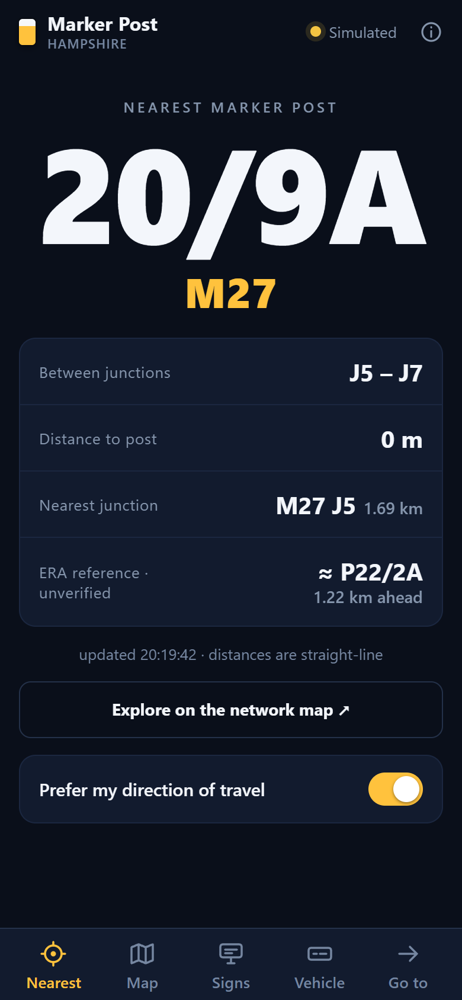
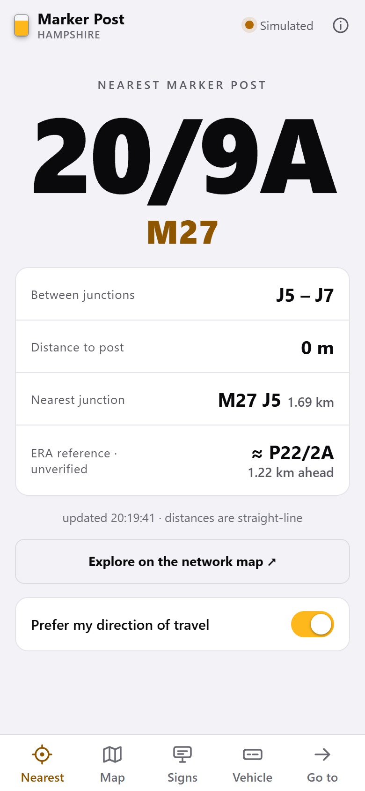
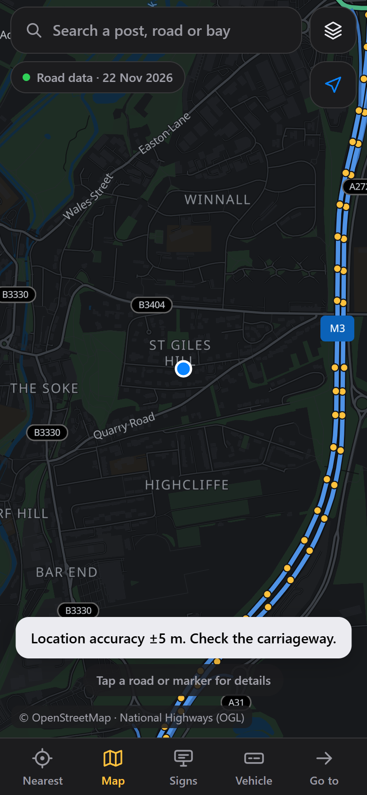

# Marker Post

The nearest National Highways marker post, for the Hampshire patch: road, post and carriageway letter, readable at a glance, working with no signal.

<p>
  
  
  
</p>

The same code runs in three places:

| Where | How you get it | Guide |
|---|---|---|
| Web app (any phone or computer) | <https://jet11111.github.io/marker-post/>, then "Add to Home Screen" | this page |
| Android app | an APK built by GitHub, installed by hand | [docs/android-app.md](docs/android-app.md) |
| iPhone app | built and uploaded to TestFlight by GitHub (no Mac needed) | [docs/ios-testflight.md](docs/ios-testflight.md) |

The phone apps add what a web page cannot do: the post on the Lock Screen, Dynamic Island and CarPlay (iPhone Live Activity), an ongoing notification (Android), home screen widgets, and tracking that carries on with the screen off.

## What it shows

- **Nearest**: the nearest marker post to your position, with the junction section (for example J5 – J7), the nearest junction and the nearest emergency area reference. With "Prefer my direction of travel" on, it picks the carriageway you are travelling along once you are moving.
- **Map**: the network, every recorded marker post, emergency areas, lay-bys and junctions on a street map. Tap a road or a marker for what is recorded about it.
- **Signs**: what the overhead signs (VMS) are showing.
- **Go to**: find a post by its reference, then open it in Waze or on the map.
- **Vehicle**: vehicle lookup (web app only for now).

### What it will not pretend

These rules are deliberate. Please keep them when changing anything.

- Unknown stays unknown. A missing record is shown as not recorded, never as "none".
- Distances are straight-line, and say so. They are not driving distances.
- A carriageway that could not be confirmed from your direction of travel is said to be so. The first page adds the line "Nearest post by position only. Check the carriageway." The Lock Screen, notification and widgets show the letter outlined instead of filled.
- Older and unverified records (for example the 2025 emergency area list) stay labelled as such.
- A position that has gone stale never looks current: the readout dims and says when the last fix was.
- Widgets show a "last updated" time and never claim to be live. The Live Activity and the Android notification are the live displays.

Where the data comes from, and its limits: [docs/marker-post-sources.md](docs/marker-post-sources.md), [docs/network-data.md](docs/network-data.md), [docs/map-feature.md](docs/map-feature.md).

## Running a command

Some steps in the guides say "in the app's folder, run" and then give a command. This is how to do that on this computer.

1. Press Start, type `cmd` and press Enter. That opens Command Prompt. Use Command Prompt, not PowerShell: PowerShell may refuse to run `npm`.
2. Paste this line and press Enter:

   ```
   cd /d %USERPROFILE%\marker-post\apps\marker-post
   ```

   That is the app's folder: the one that contains `capacitor.config.json`. It is not the outer `marker-post` folder, which is a different project.
3. Paste the command from the guide and press Enter.

The commands need three tools: Node.js 22 or newer, Git, and the GitHub command-line tool (`gh`). To check that they are there, run these one at a time. Each should answer, the first two with a version number:

```
node --version
git --version
gh auth status
```

If `gh` says you are not logged in, run `gh auth login` and answer its questions. If Windows says a command "is not recognized", that tool is not installed: Node.js comes from <https://nodejs.org>, Git from <https://git-scm.com> and `gh` from <https://cli.github.com>.

## Working on it

You need [Node.js](https://nodejs.org) 22 or newer. Nothing else for the web app: no framework, no bundler, no install step.

```sh
node scripts/serve.mjs            # the app at http://localhost:8080 (uses your real position)
node --test tests/*.test.mjs      # the tests
```

To try it without GPS, add a simulated position to the address. The app labels it "Simulated":

```
http://localhost:8080/?sim=50.93795,-1.352527,110,30      latitude, longitude, direction of travel, metres per second
http://localhost:8080/?theme=dark                         force the dark or light theme for this visit
```

`docs/mobile-preview.html` shows the real app in several phone sizes side by side.

The other commands need `npm install` once (it fetches the Capacitor tools):

```sh
npm run check          # every file parses, imports resolve, both builds work
npm run build          # the web app, as published, into www/
npm run preview        # build it and serve www/ on http://localhost:8080
npm run build:native   # the web app and lookup data for the phone apps
npm run basemap        # cut the offline street map (tiles/basemap.pmtiles, about 41 MB, not committed)
npm run screenshots    # retake the pictures on this page
```

### Layout

```
index.html, app.js, styles.css      the app shell and the Nearest, Signs, Go to and Vehicle screens
map.js, map-style.js, basemap.js    the map (MapLibre GL JS, vector tiles from one PMTiles file)
core/                               the nearest-post logic: pure functions with tests
platform.js                         everything that differs between the web and the phone apps
data/                               the published data: posts, junctions, network, emergency areas, signs
vendor/                             third-party code and map fonts, with licences and checksums
scripts/                            build, data and maintenance scripts (Node, no dependencies)
tests/                              node --test
android/, ios/                      the Capacitor shells
native/marker-post-plugin/          Swift and Kotlin: lookup, live tracking, Live Activity, widgets
worker-vms/, worker-vehicle/        the Cloudflare Workers behind Signs and Vehicle
docs/                               guides and records
```

How the phone apps are put together, and the contract between the web code and the native code: [docs/native-apps.md](docs/native-apps.md). Colours, type and components: [docs/design.md](docs/design.md).

### Publishing

- **Web app**: every push to `master` runs `.github/workflows/pages.yml`, which builds `www/` and publishes it. See [docs/going-live.md](docs/going-live.md) before merging a large change.
- **Android**: `.github/workflows/android.yml` runs the lookup tests and builds the APKs.
- **iPhone**: `.github/workflows/ios.yml` runs the Swift lookup tests and checks that the app and its widget extension compile; `.github/workflows/ios-testflight.yml` signs and uploads.
- **Data**: `network.yml` (daily) and `vms.yml` (every few minutes, when GitHub allows) refresh `data/` and republish the site.

This repository is public. No key, certificate, password or token belongs in it: signing material lives in GitHub secrets and in a separate private repository, and `.gitignore` refuses the usual file types.

## Testing on a phone and in a vehicle

What to check, and what could only be checked on a real device: [docs/testing-on-device.md](docs/testing-on-device.md).

## Licences and attribution

- Road network, emergency areas and signs: National Highways, [Open Government Licence v3.0](https://www.nationalarchives.gov.uk/doc/open-government-licence/version/3/).
- Marker posts and junctions: the [South East Region map compilation](https://www.google.com/maps/d/viewer?mid=1Pi_3GZSLypASYCfiVbP1a-kxWJiII1I). Its survey date is unknown and its licence has not been independently established: see [docs/marker-post-sources.md](docs/marker-post-sources.md).
- Street map: © [OpenStreetMap](https://www.openstreetmap.org/copyright) contributors (ODbL), as vector tiles from a [Protomaps](https://protomaps.com) build.
- Map engine and fonts: MapLibre GL JS, PMTiles, Protomaps basemaps, Noto Sans. Licences are in `vendor/`.

The OpenStreetMap and National Highways attributions stay visible on the map. The link to the marker post compilation is in Settings and about.
