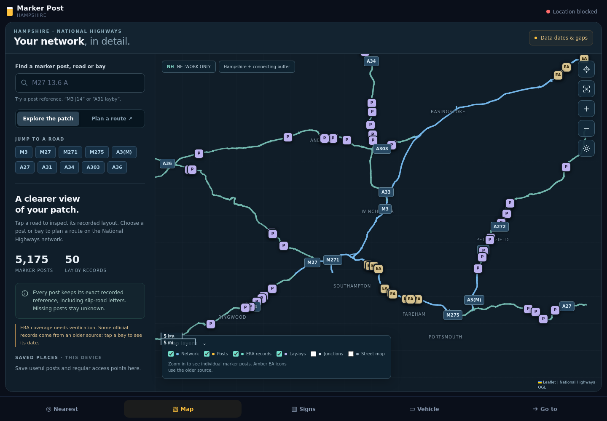
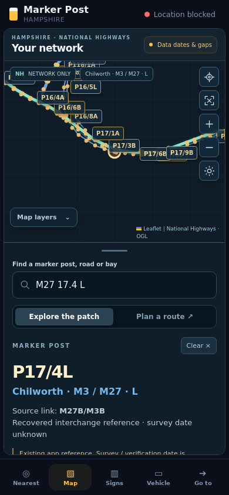

# Verification

## 22 November 2026: redesign, vector map, phone apps

What was checked, and how:

- **55 of 55 Node tests pass.** They include the nearest-post logic compared against a frozen copy of the previous implementation over 4,000 generated positions, and the existing map and routing tests.
- **The official snapshot validator passes** (`node scripts/fetch-network.mjs --validate`).
- **`node scripts/check.mjs` passes**: every script parses, every import resolves, and both the web and the phone builds are produced.
- **Headless Chrome, 390×844 in light and dark and 844×390 landscape**, with a simulated position: Nearest (including the unconfirmed-carriageway, stale and no-GPS states), Signs, Go to, Settings and about, and the Map (overview, search, selecting a marker and a road, the layer and data sheets, the Winchester and Chilworth areas, and an area away from the network). No JavaScript errors.
- **Offline**: after one visit the local server was stopped completely and the app reloaded. Nearest, Go to and the Map worked from the saved copy; Signs said it was showing a saved copy, with its age.
- **The street map file** was read back with the official PMTiles reader: 2,355 tiles, 41.1 MB.
- **Colour contrast**: every text and background pair in both themes is at least 4.5 to 1 (computed).
- **Swift and Kotlin lookup, on GitHub**: on 22 November 2026 both lookups passed against 2,056 positions whose answers are produced by the web app's own code, including near-ties. They are the "Lookup tests" job of the `ios` workflow and the "build" job of the `android` workflow.
- **Both phone apps compile, on GitHub**: on the same day the iPhone app with its widget extension, and both Android APKs, were built there.

What was not checked, and so is unknown until it is tried on a device:

- Anything on a real phone: real GPS, Safari on an iPhone, the installed web app, battery use.
- The phone apps running. Nothing has yet been run on a real phone. The Live Activity, CarPlay, widgets, the Android notification and background tracking have only been reviewed, never seen on a device. GitHub also starts the apps in an iPhone simulator and an Android emulator, but those runs are still being proven and are not counted as checks here. [testing-on-device.md](testing-on-device.md) is the list to work through.
- The map engine in WebKit. All browser checks used Chrome. The engine needs iOS 16.4 or later.

Screenshots from this check are in `docs/images/app/` and can be retaken with `npm run screenshots`.

## 24 September 2026: mobile map (the previous map, kept as a record)

- 29/29 Node routing tests passed, including one-way travel, partial links, opposite carriageways, NT/MT turn restrictions, exact-node starts, no U-turns, no disconnected jumps and no lay-by through shortcuts.
- Official snapshot validator passed (complete geometry, dates, joins and routing eligibility).
- Browser checks passed at 1440×1000 and 390×844 with no JavaScript errors and no horizontal overflow on mobile.
- Confirmed 5,175 combined posts, recovered Chilworth search and explicit network-link selection, saved post reopening, and correctly classified ERA/lay-by icons.
- M27 10.0A → 40.0A produced an 18.6-mile network route; A31 2.0A → A34 2.0A also routed through the NH network. Reachable lay-by search returned routes from the selected start.
- Failed refresh retained a clearly labelled dated snapshot. An intentionally stale snapshot refused a route. A service-worker offline reload displayed the cached map and markers with an Offline snapshot label.
- Browser tests blocked external street tiles to avoid automated tile fetching; previews show the network-only background. Real GPS, actual street-tile delivery and field accuracy were not verified by browser tests.

